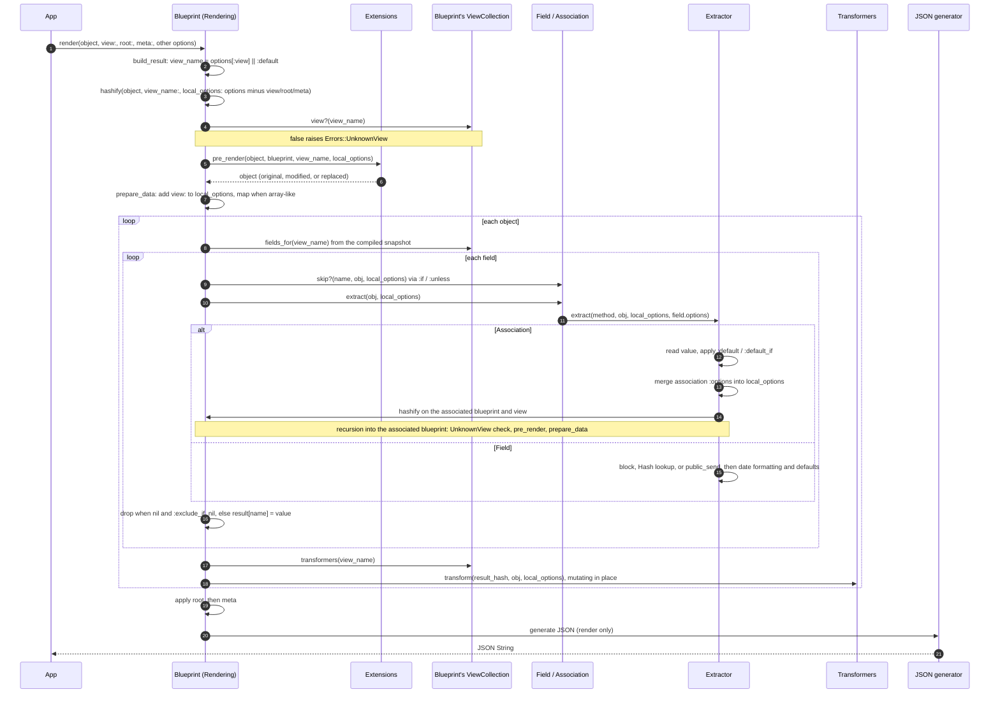
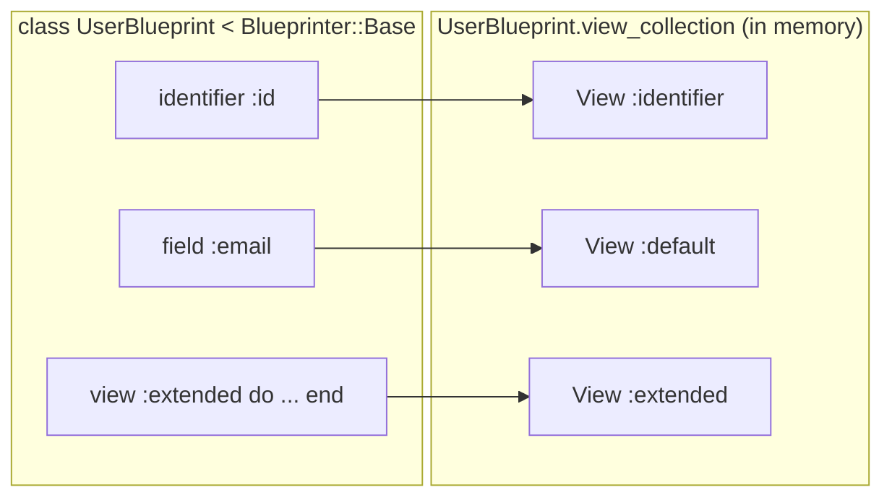
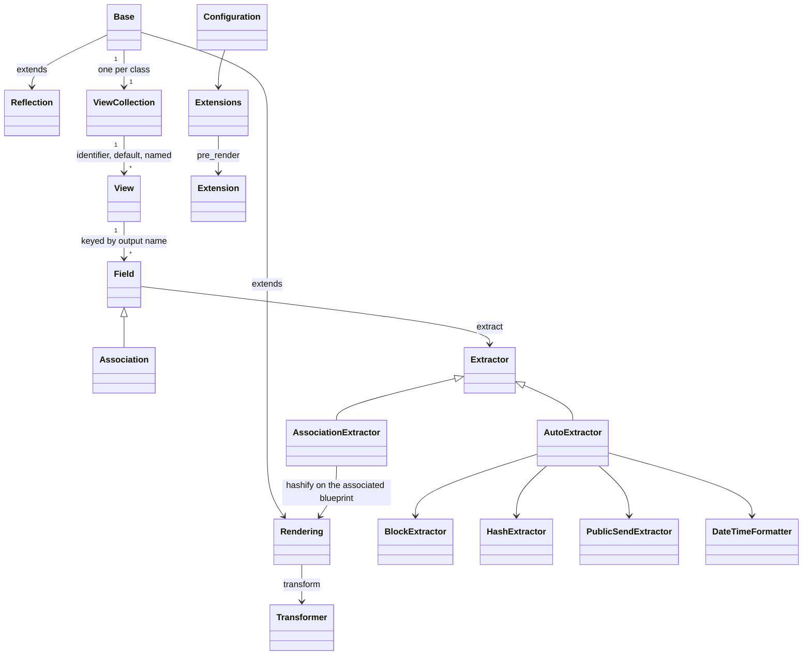

# Architecture

## Overview

`blueprinter` is a pure-Ruby presenter library. It takes business objects as input, and converts them into a specified structure.

```ruby
class VehicleBlueprint < Blueprinter::Base
  identifier :id
  field :make
end

class UserBlueprint < Blueprinter::Base
  identifier :id
  field :email

  view :extended do
    field(:full_name) { |user, **_options| "#{user.first_name} #{user.last_name}" }
    association :vehicles, blueprint: VehicleBlueprint
  end
end

UserBlueprint.render(user)
# => {"id":1,"email":"ada@example.com"}

UserBlueprint.render(user, view: :extended)
# => {"id":1,"email":"ada@example.com","full_name":"Ada Lovelace","vehicles":[{"id":7,"make":"Rivian"}]}
```

| Term                | Meaning                                                                                                                                                                        |
| ------------------- | ------------------------------------------------------------------------------------------------------------------------------------------------------------------------------ |
| **Blueprint**       | A subclass of `Blueprinter::Base`. It defines the structure of rendered data.                                                                                                  |
| **Field**           | Represents a single attribute of the desired output, and defines how to extract its value from the input object                                                                |
| **Identifier**      | A field that is rendered first in every view, typically `:id` (`identifier :id`).                                                                                              |
| **Association**     | A field whose value is another object, usually rendered via another blueprint                                                                                                  |
| **View**            | A named set of fields. `:default` holds everything declared outside a `view` block and is used when `render` receives no `view:`; every other view adds to it.                 |
| **Extractor**       | The object that reads a field's value from the input object (`Hash` lookup, `public_send`, or calling the field's block).                                                      |
| **Transformer**     | An object whose `transform(hash, object, options)` runs after a view's fields are extracted and edits the output `Hash` in place.                                              |
| **Extension**       | A globally registered object that is able to modify the input object before it is rendered.                                                                                    |
| **`local_options`** | The options passed to `render`, minus `:view`, `:root`, and `:meta`, plus the current `view:`. They reach conditions, blocks, extractors, transformers, and nested blueprints. |
| **View collection** | A blueprint's views, held by one `ViewCollection` per blueprint class.                                                                                                         |
| **Snapshot**        | Each view's final field list and transformer list, computed on the first render and frozen.                                                                                    |

Each blueprint goes through three phases:

| Phase           | When                                                       | What happens                                                                   |
| --------------- | ---------------------------------------------------------- | ------------------------------------------------------------------------------ |
| **Definition**  | The class body runs, normally at app boot                  | DSL calls build in-memory views and fields objects                             |
| **Compilation** | The first render of that blueprint                         | Each view's final field list and transformer list are computed once and frozen |
| **Render**      | Every `render`, `render_as_hash`, or `render_as_json` call | The object is walked field by field using the compiled lists                   |

## How a Render Works

Questions about rendered output (why a field is missing, why an extension saw a nested object, why `:root` only applies once) come down to _where_ in this sequence something happens:

1. `render(object, view: :extended, root:, meta:, **other)` picks the view (`:default` when none is given), and the remaining options become `local_options` (`Rendering#build_result`).
2. `Rendering#hashify` raises `Errors::UnknownView` if the blueprint has no such view, then passes the object through every registered extension's `pre_render`, which may return a replacement.
3. `Rendering#prepare_data` adds `view:` to `local_options`. If the object is **array-like** (`Array`, `ActiveRecord::Relation` when loaded, or anything in `config.custom_array_like_classes`), each element is rendered separately and the result is an `Array`.
4. For each object, each field in the view's compiled list is checked against its `:if` / `:unless` condition, read through its extractor, dropped if `nil` and marked `exclude_if_nil`, and stored under its output name. An association renders its value by calling `hashify` on its own blueprint and view, so steps 2 to 5 repeat for every nested object.
5. The view's transformers run on the finished `Hash`.
6. `:root` wraps the result and `:meta` adds a sibling key (top level only). `render` then converts to JSON with the configured generator; `render_as_hash` returns the `Hash`; `render_as_json` calls `.as_json` on it, which requires `ActiveSupport` in the host app.



### Per-Field Behavior

- `AutoExtractor` is the default extractor. It calls the field's block if there is one (`BlockExtractor`), else reads `object[name]` from a `Hash` (symbol keys only, `HashExtractor`), else calls `object.public_send(name)` (`PublicSendExtractor`). It then applies `:datetime_format` and `:default` / `:default_if`. A field's extractor is chosen when the field is defined.
- Field blocks receive `local_options` as keyword arguments. A block that takes `|obj|` or `|obj, options|` works, but one that names a keyword must also accept `**` (`{ |obj, foo:, **| ... }`), since every render passes `view:` plus all render options. That makes every key in `local_options` is part of the public contract ([public API](#public-api-and-compatibility)). `Symbol#to_proc` blocks (`field :display_name, &:formatted_full_name`) receive only the object, so they call that method on it.
- `:if` / `:unless` conditions take a `Proc`, called with `(field_name, object, local_options)`, or a `Symbol` naming a method on the blueprint class, so it must be defined with `def self.`. A field-level condition wins over `config.if` / `config.unless`. A field looks up its condition on every check until it finds one, then keeps it.
- An association runs its own blueprint's `hashify`, so the `UnknownView` check and `pre_render` run for every associated object. `:options` on an association (a `Hash`, or a `Proc` given the parent object) is merged into the nested `local_options`.
- Transformers mutate the `Hash` in place; their return value is ignored.

### Render Performance

Rendering runs once per field per object, so its cost grows with the size of the output. The **render hot path** is `Rendering#object_to_hash`, `Field#extract`, `Field#skip?`, `AutoExtractor#extract`, and `AssociationExtractor#extract`, which run once per field per object.

Changes to these methods follow three rules:

- Add no allocations on that path (`Hash#merge`, `#except`, `**` splats, `Array#map`, string formatting). The existing ones: `BlockExtractor` splats `**local_options` for each block field; `AssociationExtractor` merges association `:options` into `local_options` once per association value, and copies the field's options without `:default` / `:default_if` when either is set. `local_options` gains `:view` once per `hashify` call, not per field.
- Reuse extractor instances (`Configuration#default_extractor`, `Base.association_extractor`); never create one per field or per render.
- Include before-and-after benchmark numbers in the PR ([testing.md](testing.md#check-performance)).

## Definition

Defining a blueprint builds plain Ruby objects in memory (nothing is persisted), and everything later phases do is read from them. Each blueprint holds one **view collection**, a `ViewCollection` stored in a class-level instance variable (`Base.view_collection`), which maps view names to `View` objects. A new collection starts with two views: `:default`, and `:identifier`, which holds only identifier fields and is not rendered on its own.

DSL calls add to the **current view**: the view named by the enclosing `view(name) { ... }` block, otherwise `:default` (`Base.current_view`).

- `identifier` adds a `Field` to the `:identifier` view.
- `field` / `fields` add a `Field` to the current view. `name:` renames the output key and `extractor:` replaces the default extractor; all other options, plus the block, are stored on `Field#options` and passed to the extractor unchanged.
- `association` requires `blueprint:` (a `Base` subclass or a `Proc` that picks one per value, checked by `BlueprintValidator`) and builds an `Association`, a `Field` subclass that uses the blueprint's `AssociationExtractor`.
- `view(name) { ... }` creates the `View` on first use, runs the block with that view as current, then resets the current view to `:default` and invalidates the compiled snapshot.
- `include_view(s)`, `exclude(s)`, and `transform` record view names, excluded field names, and transformer objects on the current view.
- Subclassing a blueprint (`class AdminBlueprint < UserBlueprint`) copies the parent's views into the subclass when the subclass is defined (`ViewCollection#inherit`).



Pitfalls:

- `view` blocks do not nest. The scope resets to `:default`, not to the enclosing view, and an exception inside the block leaves the inner view current because there is no `ensure`.
- Inheritance is a one-time copy: changes to the parent after the subclass is defined do not reach it. The `Field` objects are shared, not duplicated, and each still belongs to the parent, so an inherited field's `if: :symbol` resolves against the parent class.
- A field's extractor is fixed when the field is defined (`Configuration#default_extractor` at that moment), and each blueprint's `AssociationExtractor` captures the default extractor when its first association is defined. Changing `config.extractor_default` later affects only fields defined afterwards.

## Compilation

Working out a view's final fields (defaults, included views, exclusions, sort order) is too expensive to repeat on every render, so it happens _once_. The first time a blueprint renders, `ViewCollection#ensure_cached!` computes every view's field list and transformer list in one pass and stores them as a frozen **snapshot**. Every later render reads the snapshot.

### Field Lists

```ruby
class M < Blueprinter::Base
  identifier :id
  field :name
  view(:summary) { field :status }
  view(:full) { include_view :summary; field :email; exclude :status }
end
# :default => [:id, :name]
# :summary => [:id, :name, :status]
# :full    => [:id, :email, :name]
```

For each view (`build_fields_for`):

1. Start from the `:default` view's fields, add the fields of included views (recursively), then the view's own fields. A later field with the same output name replaces an earlier one.
2. Sort by output name, or by definition order when `config.sort_fields_by = :definition` was set before the blueprint was defined.
3. Put identifier fields first, then remove every name excluded by the view or its included views. Exclusion applies to identifiers too, so `exclude :id` removes `:id`.

### Transformer Order

```ruby
class T < Blueprinter::Base
  transform D1; transform D2
  view(:v) { transform V1; transform V2 }
  view(:w) { include_view :v; transform W1 }
end
# :v runs D1, D2, V2, V1
# :w runs D1, D2, W1, V2, V1
```

The `:default` view's transformers run first, in definition order. Then come the view's own transformers, then those of included views, nearest first, and within each of those views the transformers run in reverse definition order. Duplicates are dropped. `config.default_transformers` is used only when this list is empty, so any transformer on the blueprint replaces the global ones. `spec/units/view_collection_spec.rb` pins the order for one transformer per view; the reversal within a view is not pinned and may be unintended.

### Invalidation

**Invalidation** discards the snapshot so the next render recompiles. It happens in exactly three places: after a `view` block, when a subclass inherits views, and when `ViewCollection#[]` creates a new view.

- Anything else that changes a view after the first render must call `ViewCollection#invalidate_cache!`. For example, `UserBlueprint.field :late` at runtime adds to `:default` without invalidating, so it stays invisible until something else does.
- `Base.reflections` (the introspection API that lists a blueprint's views, fields, and associations for tooling) keeps its own memo, as do `Reflection::View#fields` and `#associations`. None of them is reset, so views and fields added after the first `reflections` call are missing from it even though rendering sees them.

### Why Compile?

Compiling once keeps per-render work proportional to the fields rendered. Without the snapshot, every render rebuilds each view's field list (defaults, included views, exclusions, sorting).

Transformers follow the same inheritance as fields, so a transformer on the default view applies to every view, as a default field does, instead of being replaced by a view's own transformers. Default-first ordering is meant to give the named view the last word; with `include_view`, included views' transformers run after the including view's, so that holds only for views without inclusions.

## Extensions and Configuration

An **extension** subclasses `Blueprinter::Extension`, overrides `pre_render(object, blueprint, view, options)`, and returns the object to render. Extensions are registered globally (`config.extensions << MyExtension.new`) and run in registration order, each receiving the previous one's result. `pre_render` is the only hook, and it runs for the top-level object and every associated object. Contract details: [extension-points.md](extension-points.md#extension).

Configuration is global (`Blueprinter.configure { |config| ... }`). When each option is read decides when a change takes effect: some are read once, when a blueprint is defined or on its first render, and others on every render ([configuration.md](configuration.md#when-a-change-takes-effect)).

### Why Extensions Are Global

An extension is registered once in configuration and applies to every blueprint and every render. An `ActiveRecord` preloader (as in `blueprinter-activerecord`) reads a view's associations and preloads them on the relation before rendering, and has to cover every render call in an app. Registering globally does that in one place; the alternative is wrapping each render call and repeating its blueprint and view there. `pre_render` is the only hook; adding another is a normal change ([making-changes.md](making-changes.md#add-an-extension-hook)).

The preloader also needs to see a blueprint's structure, which `reflections` provides. `Reflection` exposes its own structs instead of the internal `View` and `Field` objects, so internal changes don't reach extension authors. `blueprinter-activerecord` uses both surfaces (its preloader is an extension that reads `reflections`), and `blueprinter_schema` reads `reflections` to generate JSON Schemas ([public API](#public-api-and-compatibility)).

## Loading Model

Blueprinter loads in two ways for two reasons. **Autoloading** lets an app reference `Extension`, `Transformer`, or an error class at boot without loading the whole library; core code loads through plain `require` chains.

- `require 'blueprinter'` autoloads `Base`, `BlueprinterError`, `Configuration`, `Deprecation`, `Errors`, `Extension`, and `Transformer` (`lib/blueprinter.rb`).
- Everything else loads through `require` chains. Loading `Configuration` brings in `Extractor`, `Extensions`, and `EmptyTypes`; `View` loads only with `Base`. Until then, referencing any of them raises `NameError`. This affects apps: a custom extractor defined as `class MyExtractor < Blueprinter::Extractor` before anything touches `Blueprinter::Base` or `Blueprinter.configuration` fails to load. It is also why `spec/units/view_spec.rb` fails when run alone ([testing.md](testing.md#when-a-spec-fails-alone)).
- A new file is either added to the autoload list (a top-level constant apps subclass or rescue) or required by the file that uses it.

## Thread Safety

A blueprint class is shared by every thread in a multi-threaded server, so anything it caches has to be safe to read concurrently.

- The only lock under `lib/` is the `Mutex` in `ViewCollection`. `ensure_cached!` checks for the snapshot without the lock, builds it under the lock with a second check, and publishes it with one reference assignment, so renders after the first take _no_ lock.
- The snapshot's `Hash`es and `Array`s are frozen; the `Field` and transformer objects inside them are not.
- The DSL is unsynchronized and assumes class bodies run before concurrent renders start.
- Not safe: DSL calls that invalidate while other threads render. `fields_for` reads the snapshot reference twice and `invalidate_cache!` writes it without the lock.

Changes must keep these invariants:

- `ensure_cached!` keeps its shape: nil-check without the lock, rebuild under the `Mutex` with a second check, publish by one reference assignment. No boolean "finalized" flag: a boolean read without the lock has no visibility guarantee on JRuby, while a frozen object published by one reference assignment is safe on every Ruby engine.
- `fields_for` and `transformers` stay lock-free reads of the snapshot after the first compile.
- Class-level state written during render must be an idempotent memo, as `Field@_if_callable`, `Configuration@_array_like_classes` and `@_default_extractor`, and the `Reflection` memos are.

## Public API and Compatibility

Downstream gems build on Blueprinter's extension and reflection surfaces ([`blueprinter-activerecord`](https://github.com/procore-oss/blueprinter-activerecord) uses both; [`blueprinter_schema`](https://github.com/thisismydesign/blueprinter_schema) reads `reflections`). A change that alters rendered output, a public signature, an error class, or the reflection shape is **breaking** even when every spec passes.

**Public API** is everything not tagged `@api private` that users call, subclass, or override as the README or YARD documents: every public class method on `Blueprinter::Base` (the DSL, `render`, `render_as_hash`, `render_as_json`, `hashify`, `view?`, `view_collection`, `reflections`), every `Configuration` accessor and accepted value, and the base classes `Extension`, `Extractor`, `AutoExtractor`, `Transformer`, and `BlueprinterError`. Ruby visibility doesn't decide it: `AutoExtractor#extractor` is private but tagged `@api public`, because subclasses override it. Anything tagged `@api private` is internal and can change without a deprecation.

- **MUST NOT** make a breaking change (removing or renaming anything public, or changing the default output of an existing option such as field sort order, nil handling, or `default_if` semantics) in a patch release.
- **MAY** make one in a minor or major release only when the release's CHANGELOG carries a ‼️ `[BREAKING]` entry for it, and, for a removal, at least one earlier release emitted a `Blueprinter::Deprecation.report` warning naming the replacement. Procedure: [making-changes.md](making-changes.md#add-a-deprecation).

Surfaces that are public even though they don't look like it:

- Every key in `local_options`. `BlockExtractor` passes `local_options` to field blocks as keyword arguments, so a block that names every keyword it receives without a `**` catch-all (`{ |obj, view:, current_user:| ... }`) raises `ArgumentError: unknown keyword` as soon as a new key appears. Adding a key (one the gem injects at render, one merged in `AssociationExtractor`, or a stripped key put back) is breaking.
- The `Reflection::Field` / `Reflection::Association` struct members and the shape of `Base.reflections`.
- The `Extension#pre_render(object, blueprint, view, options)` signature, registration order, and each extension receiving the previous one's result.
- The error class hierarchy. New errors go under `Blueprinter::Errors` as subclasses of `BlueprinterError`, so existing `rescue Blueprinter::BlueprinterError` blocks keep working while callers can rescue the new case separately. `Errors::UnknownView`, for example, lets apps answer a bad view name with a 400 without also catching server faults.
- Every accepted configuration value, including `:stderror` for `deprecations`, which the README spells `:stderr` ([configuration.md](configuration.md#notes)).

| Area                        | Public                                                                                                                           | Marked `@api private`                                                                                    |
| --------------------------- | -------------------------------------------------------------------------------------------------------------------------------- | -------------------------------------------------------------------------------------------------------- |
| Definition DSL              | `Base` DSL methods, `view?`, `view_collection`                                                                                   | `View`, `ViewCollection`, `Field`, `Association`, `BlueprintValidator`                                   |
| Rendering                   | `render`, `render_as_hash`, `render_as_json`, `hashify`, `Extractor`, `AutoExtractor` (including its `extractor` override point) | `BlockExtractor`, `HashExtractor`, `PublicSendExtractor`, `AssociationExtractor`, `prepare` (deprecated) |
| Configuration and extension | `Blueprinter.configure`, every `Configuration` accessor, `Extension`, `Transformer`                                              | `Deprecation`                                                                                            |
| Reflection                  | `Base.reflections`, `Reflection::View#fields` / `#associations`                                                                  | none                                                                                                     |
| Errors                      | `BlueprinterError` and every class under `Errors`, plus `DateTimeFormatter::InvalidDateTimeFormatterError`                       | none                                                                                                     |
| Rails integration           | `rails g blueprinter:blueprint`                                                                                                  | none                                                                                                     |

## Reference

### Class Relationships



Start reading at `lib/blueprinter/base.rb` (DSL), `lib/blueprinter/rendering.rb` (render path), and `lib/blueprinter/view_collection.rb` (compilation).

### External Dependencies

| Dependency                 | Kind                                                                    | Where                                               |
| -------------------------- | ----------------------------------------------------------------------- | --------------------------------------------------- |
| `json` (stdlib)            | Required at load                                                        | `lib/blueprinter/configuration.rb`                  |
| `ActiveRecord::Relation`   | Optional, detected with `defined?`                                      | `Configuration#array_like_classes`                  |
| `ActiveSupport` `#as_json` | Optional, called at runtime                                             | `Rendering#render_as_json`                          |
| `Oj`, `Yajl::Encoder`      | Optional JSON generators through `config.generator` and `config.method` | `Configuration#jsonify`                             |
| `Rails` generators         | Optional; loaded by `Rails`, not by the gem                             | `lib/generators/blueprinter/blueprint_generator.rb` |

- Ruby floor is `>= 3.1` (`blueprinter.gemspec`); CI runs 3.1, 3.2, 3.3, and 4.0 (`.github/workflows/test.yaml`); `RuboCop` targets 3.1. Code must not use syntax or stdlib newer than 3.1 (no `Data.define`, no `it` block parameter).
- No runtime dependency is added to the gemspec without maintainer agreement, and nothing under `lib/` requires `ActiveRecord`, `ActiveSupport`, `Oj`, or `Yajl`. Optional integrations are detected (`defined?(ActiveRecord::Relation)`) or configured (`config.generator`); development-only gems live in the `Gemfile`.

The `Rails` generator ships in the gem but is loaded by `Rails`, not by `require 'blueprinter'`, and is excluded from `RuboCop` and `YARD`.
